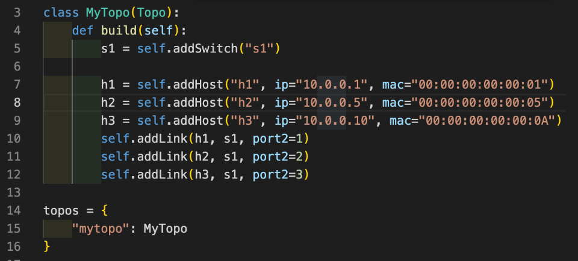
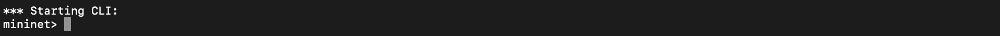
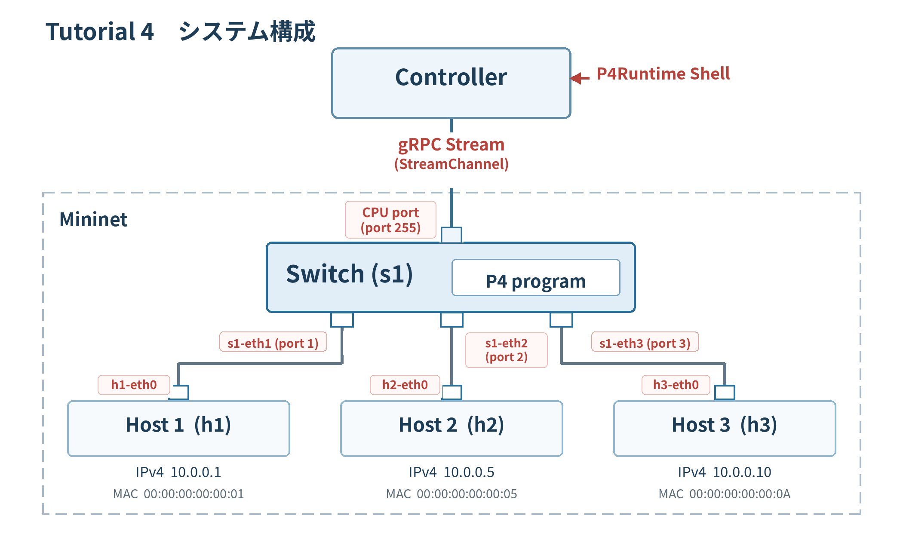

## Tutorial 4: 宛先IPアドレスによる exact match 通信

Tutorial 3の宛先MACアドレスによるテーブル転送をもとに、今回は「宛先IPv4アドレス」で転送先ポートを決めます。

### 目的

このチュートリアルの目的は、P4スイッチが宛先IPv4アドレスを調べ、登録された転送ルールに従ってパケットを送る仕組みを、実行結果と結び付けて理解することです。

実習では、P4プログラムの編集やコンパイルは行いません。配布したJSON・P4Infoをそのまま利用します。

### 実験の仕組み

#### Tutorial 3とTutorial 4の違い

| **比較する点**       | **Tutorial 3**       | **Tutorial 4**             |
|----------------------|----------------------|----------------------------|
| スイッチが調べる情報 | 宛先MACアドレス      | 宛先IPv4アドレス           |
| 検索キー             | hdr.ethernet.dstAddr | hdr.ipv4.dstAddr           |
| 一致の判定           | exact（完全一致）    | exact（完全一致）          |
| 一致したとき         | 指定ポートへ転送     | 指定ポートへ転送           |
| 一致しないとき       | 登録された既定処理へ | 今回のプログラムではdrop() |

#### 宛先IPアドレスをテーブルで検索する

| **宛先IPアドレス** | **一致した場合の処理** | **送信先**   |
|--------------------|------------------------|--------------|
| 10.0.0.1           | forward(1)             | h1 / ポート1 |
| 10.0.0.5           | forward(2)             | h2 / ポート2 |
| 10.0.0.10          | forward(3)             | h3 / ポート3 |

例えば宛先IPが10.0.0.5のパケットを受信すると、10.0.0.5の行が完全一致し、forward(2)でポート2から送信されます。なお、この表は実習の最後に完成する状態です。

#### P4プログラムは何をしているか

配布ファイル proto03_ip.p4 の重要部分です。左の数字は元ファイルの行番号を表します。

**P4コード抜粋｜出力ポート・テーブル・破棄条件**

```p4
70 action forward(egressSpec_t port) {
71 standard_metadata.egress_spec = port;
72 }
74 action drop() {
75 mark_to_drop(standard_metadata);
76 }
78 table ipv4_table {
79 key = {
80 hdr.ipv4.dstAddr : exact;
81 }
82 actions = { forward; drop; }
86 size = 1024;
87 default_action = drop();
88 }
90 apply {
91 if (hdr.ipv4.isValid()) {
92 ipv4_table.apply();
93 } else {
94 drop();
95 }
96 }
```

| **コード**                       | **意味**                                       |
|----------------------------------|------------------------------------------------|
| 70〜71行目 / forward(port)       | 指定した番号をスイッチの出力ポートに設定する   |
| 78〜80行目 / ipv4_table          | IPv4の宛先IPアドレスをexactで照合する          |
| 87行目 / default_action = drop() | 一致する転送ルールがないIPv4パケットを破棄する |
| 91〜92行目 / isValid()とapply()  | IPv4ヘッダが有効な場合にテーブルを検索する     |
| 93〜94行目 / elseとdrop()        | IPv4ヘッダが有効でなければパケットを破棄する   |

重要：h3宛てのルール未登録でpingが失敗する場合は「91行目でIPv4と判断 → 92行目でテーブル検索 → 一致なし → 87行目のdrop()」という順番です。94行目はIPv4ヘッダが有効でない場合の破棄で、別の条件です。

### システム構成

実験では、P4Runtime Shellをコントローラ役として使い、Mininet内のP4スイッチs1と3台のホストh1・h2・h3を接続します。P4Runtime ShellはgRPC通信でスイッチの転送ルールを登録し、各ホストのpingパケットはスイッチのポート1〜3を通ります。構成図とホストの設定値はSTEP 03で確認します。

### 実験の手順

STEP 01からSTEP 09まで順番に進めます。操作する場所（ターミナルA・B）と入力内容を区別してあります。

以下の実行例にある `$`、`mininet>`、`P4Runtime sh >>>` は入力待ちの表示です。実際には、その後に続くコマンドを入力してください。

## STEP 01 配布ファイルを準備する

| **ファイル**            | **役割**                                   |
|-------------------------|--------------------------------------------|
| custom_topo.py          | ホスト3台と接続先を定義                    |
| proto03_ip.json         | コンパイル済みのP4スイッチプログラム       |
| proto03_ip_p4info.txtpb | テーブル・アクションをP4Runtimeに知らせる  |
| proto03_ip.p4           | 仕組みを読むためのソースコード（編集不要） |

配布ZIPを解凍して、tutorial4_ip_exactフォルダーを「ダウンロード」に配置した例です。

Macのターミナルで、作業用のフォルダを作成してファイルをコピーします。

```console
$ mkdir -p /tmp/tutorial4_ip_exact
```

`mkdir -p`で、実習に使用するフォルダを作成します。

```console
$ cp ~/Downloads/tutorial4_ip_exact/* /tmp/tutorial4_ip_exact/
```

`cp`で、ダウンロードした配布ファイルを作業用フォルダにコピーします。正常に完了した場合、通常は何も表示されません。

### Mininet 環境の立ち上げ

## STEP 02 Mininetを起動する

Mininetの起動時にcustom_topo.pyを読み込み、ホストとスイッチの接続構成を作成します。最初に、このファイルの内容を確認します。

**起動時に使用するファイル｜custom_topo.py（3〜16行目）**

下の画像は、配布するcustom_topo.pyをVS Codeで開いた画面です。各行で設定している内容を確認してから、Mininetを起動します。



*図：custom_topo.py の3〜16行目（提供されたVS Code画面より）*

**行番号と設定内容の対応**

| 行番号 | 設定している内容とその意味 |
| --- | --- |
| 3〜4行目 | class MyTopo(Topo) / def build(self)<br>Mininetで作成する仮想ネットワークの構成をMyTopoクラスにまとめ、その中で機器や接続を定義します。 |
| 5行目 | addSwitch("s1")<br>「s1」という名前のP4スイッチを1台作成します。 |
| 7〜9行目 | addHost("h1" / "h2" / "h3", ip=..., mac=...)<br>3台のホストを作り、それぞれにIPアドレスとMACアドレスを設定します。例：h2はIP 10.0.0.5、MAC 00:00:00:00:00:05です。 |
| 10〜12行目 | addLink(h1, s1, port2=1) など<br>各ホストをs1に接続します。port2は2番目の引数である「スイッチs1側」のポート番号を指定します。h1→ポート1、h2→ポート2、h3→ポート3です。 |
| 14〜16行目 | topos = {"mytopo": MyTopo}<br>上で定義したネットワーク構成に「mytopo」という呼び出し名を付けます。Mininet起動時の --topo mytopo がこの名前を指定しています。 |

ここで作られるのは「ホスト・スイッチ・接続」の構成です。10〜12行目で接続ポートが決まっても、P4スイッチに宛先IPアドレスの転送ルールが自動登録されるわけではありません。転送ルールは後のSTEPでP4Runtimeから登録します。

**起動コマンドで使う「mytopo」とは？**

Mininetでは、ホストとスイッチの接続構成を「トポロジー」と呼びます。上のcustom_topo.pyには、その構成を定義するMyTopoクラスがあります。

ファイル末尾の topos = {"mytopo": MyTopo} は、この構成を「mytopo」という名前で登録する指定です。起動コマンドの --custom でファイルを読み込み、--topo mytopo でその構成を選択します。

ターミナルAで、次のようにMininetを起動します。**コマンドと起動時の出力を1つのターミナル表示にまとめた例**です。

```console
$ docker run --privileged --rm -it \
  -p 50001:50001 \
  -v /tmp/tutorial4_ip_exact:/tutorial4 \
  -e LOGLEVEL=debug -e PKTDUMP=true -e IPV6=false \
  yutakayasuda/p4mn \
  --custom /tutorial4/custom_topo.py --topo mytopo --arp
*** Error setting resource limits. Mininet's performance may be affected.
*** Creating network
*** Adding controller
*** Adding hosts:
h1 h2 h3
*** Adding switches:
s1
*** Adding links:
(h1, s1) (h2, s1) (h3, s1)
*** Configuring hosts
h1 h2 h3
*** Starting controller
*** Starting 1 switches
s1 ... ⚡ simple_switch_grpc @ 50001
*** Starting CLI:
mininet>
```

`--custom`はcustom_topo.pyを読み込み、`--topo mytopo`は先ほど説明した接続構成を選びます。

Tutorial 0では`--mac`を使いますが、今回はcustom_topo.pyに各ホストのMACアドレスが指定されているので、`--mac`を付けません。

`--arp`を指定することで、各ホストに通信相手のIPアドレスとMACアドレスの対応をあらかじめ登録します。これにより、ARPによるアドレスの問い合わせを省略し、今回のチュートリアルではARPの処理を含めず、宛先IPアドレスによるパケット転送の仕組みを分かりやすく学習できるようにしています。

`mininet>`が表示されれば、Mininetのコマンドを入力できます。起動ログの警告や詳しい表示は、環境により異なります。



## STEP 03 接続構成とホスト設定を確認する

下の図は、P4Runtime Shell・P4スイッチ・3台のホストの関係を示しています。上のControllerからスイッチへの線は転送ルールを設定するgRPC通信、下の3本の線はホストがIPv4パケットを送受信するEthernet接続です。



**P4Runtimeによる制御通信**

P4Runtimeでは、コントローラーとスイッチの間をgRPCで接続し、転送ルールなどの制御情報をやり取りします。今回の実験では、Mininet起動時にgRPC接続用のTCPポート50001を公開します。P4Runtime Shellの起動時には、接続先のホスト名とポート番号（`host.docker.internal:50001`）を指定します。

**接続構成の見方**

スイッチs1のport 1・2・3は、順番にh1・h2・h3のeth0へ接続しています。s1-eth1などはスイッチ側、h1-eth0などはホスト側のインターフェース名です。

ホストのIPアドレスとMACアドレスはcustom_topo.pyで設定されます。一方、宛先IPアドレスに対応するスイッチの転送ルールは、P4Runtime Shellから別に登録します。

**ホスト設定・接続ポートの一覧**

| **ホスト** | **IPv4アドレス** | **MACアドレス**   | **接続するIF**    | **s1のポート** |
|------------|------------------|-------------------|-------------------|----------------|
| h1         | 10.0.0.1         | 00:00:00:00:00:01 | h1-eth0 ↔ s1-eth1 | 1              |
| h2         | 10.0.0.5         | 00:00:00:00:00:05 | h2-eth0 ↔ s1-eth2 | 2              |
| h3         | 10.0.0.10        | 00:00:00:00:00:0A | h3-eth0 ↔ s1-eth3 | 3              |

IPアドレスとMACアドレスはcustom_topo.pyの7〜9行目、接続ポートは10〜12行目の設定に対応します。MACアドレスはEthernet通信に必要なホストの設定ですが、この実験でP4スイッチが照合するのは宛先IPv4アドレスです。

##### Mininetのコマンドで設定を表示する

ターミナルAの `mininet>` で接続構成とホストの設定を確認します。同じ種類の確認は最初の1例だけコマンドと出力を掲載し、残りは同じ操作を応用します。

**① ホストとスイッチの接続を確認する**

```console
mininet> net
h1 h1-eth0:s1-eth1
h2 h2-eth0:s1-eth2
h3 h3-eth0:s1-eth3
s1 lo: s1-eth1:h1-eth0 s1-eth2:h2-eth0 s1-eth3:h3-eth0
mininet>
```

`net`は接続関係を一覧表示します。h1はs1-eth1、h2はs1-eth2、h3はs1-eth3につながっていることが分かります。

**② h1のIPv4アドレスを確認する**

```console
mininet> h1 ip -4 addr show dev h1-eth0
inet 10.0.0.1/8 scope global h1-eth0
mininet>
```

h1のインターフェース`h1-eth0`に、IPv4アドレス`10.0.0.1/8`が設定されていることを確認します。

**③ h2・h3のIPv4アドレスを確認する**

②で使用したコマンドの**ホスト名とインターフェース名を、確認したいホストに合わせて変更**し、h2とh3についても実行してください。

実行結果では、h2の`h2-eth0`に`10.0.0.5/8`、h3の`h3-eth0`に`10.0.0.10/8`が設定されていることを確認します。

**④ h2のMACアドレスを確認する**

```console
mininet> h2 ip link show dev h2-eth0
link/ether 00:00:00:00:00:05 brd ff:ff:ff:ff:ff:ff
mininet>
```

h2の`link/ether`に表示されるMACアドレスが`00:00:00:00:00:05`であることを確認します。h1・h3も同様に、ホスト名とインターフェース名を変更して確認できます。

上記は配布設定から作成した出力例（要点抜粋）です。実際のMininetでは、各コマンドの詳細情報やインターフェース番号なども表示されます。

**各コマンドで確認できること**

| **入力コマンドの種類**  | **何が分かるか**                                           |
|-------------------------|------------------------------------------------------------|
| net                     | h1-eth0がs1-eth1、h2-eth0がs1-eth2、h3-eth0がs1-eth3に接続 |
| ip -4 addr show dev ... | 指定したインターフェースのIPv4アドレス（例：10.0.0.1/8）   |
| ip link show dev ...    | 指定したインターフェースのMACアドレス（例：00:...:05）     |

### P4Runtime Shell

## STEP 04 P4Runtime Shellでスイッチに接続する

ターミナルBでP4Runtime Shellを起動し、今回使用するP4プログラムをスイッチに設定して接続します。

ターミナルBを開き、次のコマンドで接続します。

```console
$ docker run --rm -ti \
  -v /tmp/tutorial4_ip_exact:/tutorial4 \
  p4lang/p4runtime-sh \
  --grpc-addr host.docker.internal:50001 \
  --device-id 1 --election-id 0,1 \
  --config /tutorial4/proto03_ip_p4info.txtpb,/tutorial4/proto03_ip.json
*** Welcome to the IPython shell for P4Runtime ***
P4Runtime sh >>>
```

このコマンドでは`--grpc-addr`で接続先、`--config`で使用するP4InfoとJSONファイルを指定します。`P4Runtime sh >>>`が表示されれば、転送ルールを操作できます。

## STEP 05 転送テーブルの定義を確認する

P4Runtime Shellから、読み込まれたP4プログラムの転送テーブルとその定義を確認します。

**コマンドと出力①｜存在するテーブル一覧**

```console
P4Runtime sh >>> tables
MyIngress.ipv4_table
P4Runtime sh >>>
```

この結果から、P4スイッチに「MyIngress.ipv4_table」というテーブルが存在することが分かります。

**コマンドと出力②｜テーブル定義の詳細**

```console
P4Runtime sh >>> tables["MyIngress.ipv4_table"]
Out[5]:
preamble {
id: 50177836
name: "MyIngress.ipv4_table"
alias: "ipv4_table"
}
match_fields {
id: 1
name: "hdr.ipv4.dstAddr"
bitwidth: 32
match_type: EXACT
}
action_refs {
id: 29683729 ("MyIngress.forward")
}
action_refs {
id: 25652968 ("MyIngress.drop")
}
initial_default_action {
action_id: 25652968
}
size: 1024
P4Runtime sh >>>
```

`tables["MyIngress.ipv4_table"]`は、テーブルの検索キー・一致方法・利用できるアクションを表示します。特に`hdr.ipv4.dstAddr`と`EXACT`を確認してください。

##### 出力結果の読み方

| **表示項目**           | **意味**                               |
|------------------------|----------------------------------------|
| name / alias           | テーブルの正式名と短い別名             |
| hdr.ipv4.dstAddr       | 検索キーとして使う宛先IPv4アドレス     |
| bitwidth: 32           | 検索フィールドの長さは32ビット         |
| match_type: EXACT      | 完全一致で検索する                     |
| MyIngress.forward      | 一致したエントリの指定ポートへ転送する |
| MyIngress.drop         | パケットを破棄するアクション           |
| initial_default_action | 初期設定の既定アクションはdrop         |
| size: 1024             | 登録可能なエントリの上限               |

表示例の「Out[5]」の数字は実行した順番で変わります。その他の定義は、配布ファイル proto03_ip_p4info.txtpb と対応しています。実際のスイッチから採取したログではありません。

## STEP 06 h1とh2の転送ルールを登録する

pingの要求と返信を両方向で転送できるよう、最初はh1とh2の2件を登録します。

P4Runtime Shellで、まずh1宛てのルールを登録します。

```console
P4Runtime sh >>> te = table_entry["MyIngress.ipv4_table"](action="MyIngress.forward")
P4Runtime sh >>> te.match["hdr.ipv4.dstAddr"] = "10.0.0.1"
P4Runtime sh >>> te.action.set(port="1")
P4Runtime sh >>> te.insert()
P4Runtime sh >>>
```

`table_entry`でエントリを作り、`te.match`で宛先IP、`te.action.set`で出力ポートを指定します。最後の`te.insert()`で、**10.0.0.1宛てはポート1へ転送**するルールを登録します。正常な登録時には通常、出力はありません。

続けて、**h2宛てのルールも同じ手順で登録してください。** 最初から新しいエントリを作り、宛先IPアドレスを`10.0.0.5`、出力ポートを`2`に変更して登録します。

これで、h1宛てはポート1、h2宛てはポート2へ転送する2件のルールが揃います。両方向の転送ルールがあるため、pingの要求と返信を転送できるようになります。

##### 登録した2件を確認する

登録したエントリを読み出します。以下は、実際の出力に含まれる登録内容を読みやすく要約した表示例です（Shellの出力形式そのものではありません）。

```console
P4Runtime sh >>> table_entry["MyIngress.ipv4_table"].read(lambda e: print(e))
... hdr.ipv4.dstAddr = 10.0.0.1 / MyIngress.forward(port=1)
... hdr.ipv4.dstAddr = 10.0.0.5 / MyIngress.forward(port=2)
P4Runtime sh >>>
```

`read()`で登録済みのエントリを読み出し、h1とh2に対応する2件のルールが存在することを確認します。

| **登録された宛先IP** | **実行するアクション** |
|----------------------|------------------------|
| 10.0.0.1             | forward(1) → h1        |
| 10.0.0.5             | forward(2) → h2        |

表は読み出した登録内容を分かりやすく整理したものです。Shellが表示する実際のP4Runtimeエントリは、より詳しい形式です。

### pingによる通信の確認

## STEP 07 pingで成功と失敗を比較する

まずh1からh2へ送信し、次に未登録のh3宛へ送信します。

ターミナルAのMininetで、続けて2つの通信を試します。まず、登録済みのh2へ送信します。

**① h1からh2へpingを送信する（成功例）**

```console
mininet> h1 ping -c 3 h2
PING 10.0.0.5 (10.0.0.5) 56(84) bytes of data.
64 bytes from 10.0.0.5: icmp_seq=1 ttl=64 time=0.45 ms
64 bytes from 10.0.0.5: icmp_seq=2 ttl=64 time=0.31 ms
64 bytes from 10.0.0.5: icmp_seq=3 ttl=64 time=0.36 ms
--- 10.0.0.5 ping statistics ---
3 packets transmitted, 3 received, 0% packet loss
mininet>
```

`ping -c 3`で3回送信します。`3 received`と`0% packet loss`が表示され、h2への通信が成功したと分かります。宛先のh2と返信先のh1は、どちらも転送テーブルに登録済みです。

**② h1からh3へpingを送信する（失敗例）**

①と同じ方法で、今度はh1からh3へ3回pingを送信してください。**送信先のホストだけをh3に変更**します。

h3宛ての`10.0.0.10`はまだ転送テーブルに登録されていないため、実行結果では**`3 packets transmitted, 0 received, 100% packet loss`**となることを確認します。

これは応答が届かなかったことを示します。スイッチの`default_action = drop()`によって、h3宛ての要求パケットが破棄されるためです。

通信結果はコードと設定から想定した例で、実測ログではありません。応答時間などは環境によって変わります。

## STEP 08 h3宛ての転送ルールを追加する

トポロジーにはすでにh3が接続されていますが、転送テーブルにはまだh3宛てのルールがありません。そこで10.0.0.10宛てをポート3に転送するルールを追加します。

ターミナルBのP4Runtime Shellで、**STEP 06のh1宛てルールと同じ手順**を実行してください。新しいエントリを作成し、宛先IPアドレスを`10.0.0.10`、出力ポートを`3`に指定して登録します。

登録後は、STEP 06で使ったエントリの読み出し操作をもう一度実行します。h1・h2に加えて、**10.0.0.10宛てをポート3へ転送するルールが表示され、合計3件になっている**ことを確認してください。

## STEP 09 再びpingして返信を確認する

ターミナルAのMininetで、STEP 07と同じ方法でpingを実行します。

**① h1からh3へpingを再実行する**

先ほど失敗したh1からh3へのpingを、もう一度3回送信してください。今度はh3宛ての転送ルールが登録されているため、**`3 packets transmitted, 3 received, 0% packet loss`**と表示され、通信が成功することを確認します。

**② h2からh3へpingを送信する**

続けて、送信元をh2、送信先をh3に変更し、同じように3回pingを送信してください。こちらも**3回送信・3回受信・パケット損失0%**となれば成功です。

h3宛てはポート3、返信先のh1・h2宛てはそれぞれポート1・2へ転送するルールが登録されているため、返信が届きます。

### 通信結果とP4コードの対応

通信の成功・失敗は、IPアドレスの登録内容とP4プログラムの条件分岐によって決まります。

| **通信例**                 | **P4スイッチの処理**                                         | **結果** |
|----------------------------|--------------------------------------------------------------|----------|
| h1 → h2（登録済み）        | 91〜92行目でipv4_tableを検索し、10.0.0.5と一致 → forward(2)  | 応答あり |
| h1 → h3（未登録）          | 91〜92行目でipv4_tableを検索し、一致なし → 87行目のdrop()    | 応答なし |
| h1 → h3（登録後）          | 91〜92行目でipv4_tableを検索し、10.0.0.10と一致 → forward(3) | 応答あり |
| IPv4ヘッダが有効でない場合 | 91行目の条件が成立せず、93〜94行目のdrop()                   | 破棄     |

#### P4コードの実行順序を整理

プログラムの処理（91〜94行目）

```p4
if (hdr.ipv4.isValid()) { // IPv4ヘッダが有効か
ipv4_table.apply(); // 有効なら宛先IPのテーブルを検索
} else {
drop(); // 有効でなければ破棄
}
```

テーブルに登録されていないIPv4宛先の破棄は、このif文のelseではなく、テーブル内の`default_action = drop();`（87行目）によるものです。今回の失敗例をARPの有無と結び付ける必要はありません。

本資料のコマンド出力とping返信は、提供された設定ファイルを基にした説明用の表示例です。Docker・Mininetを起動した実測ログではありません。
