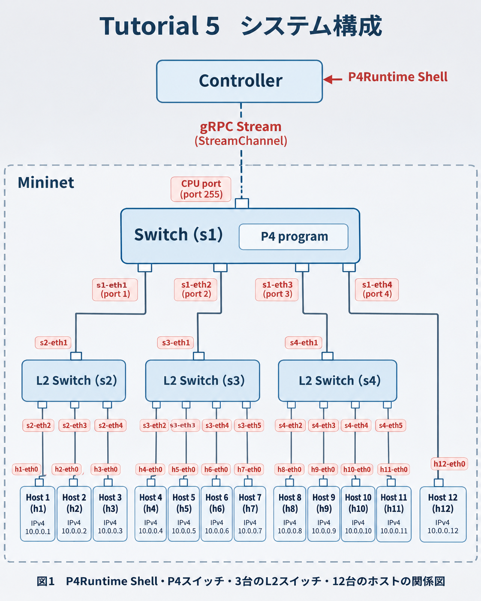

# Tutorial 5: LPMによる宛先IPv4アドレスの転送

Tutorial 4では、宛先IPv4アドレスの完全一致（exact match）によって出力ポートを決定した。本チュートリアルでは、同じ宛先IPv4アドレスを検索キーとし、最長プレフィックス一致（Longest Prefix Match：LPM）による転送を実行する。

## 目的

IPv4アドレスのプレフィックス長に基づくテーブル検索を行い、次の2点を確認する。

1. 1つのLPMエントリが、複数の宛先IPv4アドレスに一致すること。
2. 複数のエントリが一致した場合、プレフィックス長が最も長いエントリが選択されること。

## システム構成

次の関係図に本実験のネットワーク構成を示す。P4Runtime Shellは、gRPC通信を介してP4スイッチs1の転送テーブルにエントリを登録する。



図1：P4スイッチs1、3台のL2スイッチ、および12台のホストの接続関係。実線はデータ転送用リンク、点線はP4Runtimeによる制御通信を表す。

## LPMの概要

LPM（Longest Prefix Match：最長プレフィックス一致）とは、宛先IPアドレスと転送テーブルに登録されたネットワークプレフィックスを比較し、一致するエントリのうちプレフィックス長が最も長いものを選択する方式である。

Tutorial 4で使用したexact matchは、宛先IPv4アドレスが登録されたアドレスと完全に一致する場合にエントリを選択する。一方、LPMでは、共通するネットワークプレフィックスを持つ複数のIPアドレスに対して、1つのエントリで同じ転送ルールを適用できる。

### プレフィックス長と一致範囲

IPv4アドレスは32ビットで構成される。LPMでは、プレフィックス長を用いて、IPアドレスの先頭から何ビットを比較するかを指定する。プレフィックス長を30ビットとした場合、先頭30ビットが比較対象となり、残りの2ビットは比較対象とならない。

例えば、転送テーブルに次のエントリを登録した場合を考える。

```text
10.0.0.4/30 → port2
```

`10.0.0.4/30`の末尾にある`/30`は、プレフィックス長が30ビットであることを表す。比較しない部分はワイルドカードとして扱われ、末尾2ビットが`00`、`01`、`10`、`11`のいずれであっても一致する。

| 項目 | 値 |
| --- | --- |
| ネットワークプレフィックス | `10.0.0.4/30` |
| サブネットマスク | `255.255.255.252` |
| 比較対象 | 先頭30ビット |
| 比較対象外（ワイルドカード） | 末尾2ビット |

`10.0.0.4/30`では、IPv4アドレスの先頭30ビットを比較し、最後の2ビットは比較しない。そのため、最後の2ビットだけが異なる`10.0.0.4`から`10.0.0.7`までの4つのIPアドレスが、同じエントリに一致する。

| 宛先IPv4アドレス | 最後の8ビット | `10.0.0.4/30`との一致 |
| --- | --- | --- |
| `10.0.0.4` | `00000100` | 一致 |
| `10.0.0.5` | `00000101` | 一致 |
| `10.0.0.6` | `00000110` | 一致 |
| `10.0.0.7` | `00000111` | 一致 |

したがって、4つの宛先IPv4アドレスは1つの`/30`エントリに一致する。

`10.0.0.5`をプレフィックス長30ビットで照合する場合も、`10.0.0.4/30`の範囲に含まれる。転送テーブルには、末尾2ビットを0にした`10.0.0.4/30`を登録する。

## 実験環境

Mininet上に1台のP4スイッチ（`s1`）、3台のL2スイッチ（`s2`～`s4`）、12台のホスト（`h1`～`h12`）を配置する。各ホストには、`10.0.0.1`から`10.0.0.12`までのIPv4アドレスを割り当てる。

各ホストのサブネットマスクは`255.255.255.0`（プレフィックス長24ビット）に設定する。したがって、12台のホストはIPアドレスの設定上、同一の`10.0.0.0/24`ネットワークに属する。一方、P4スイッチs1のLPM転送テーブルには、プレフィックス長30ビットのエントリを登録し、宛先IPv4アドレスに基づいて出力ポートを決定する。**ホスト側の`/24`はネットワークの設定であり、転送テーブル側の`/30`は一致判定に使用する条件である。**

s2～s4は、Linuxカーネルのブリッジ機能で動作するMACアドレス学習型のL2スイッチである。s1はLPMで出力ポートを選択し、接続先のL2スイッチが宛先MACアドレスに基づいて各ホストへEthernetフレームを転送する。h12のみs1に直接接続する。

### トポロジーファイル（`custom_topo.py`）

本実験で使用する`custom_topo.py`の主要部分を以下に示す。このファイルでは、スイッチとホストの配置、および各機器間の接続関係を定義する。

**プログラム｜トポロジーファイルの主要部分（抜粋）**

```python
# スイッチの追加
s1 = self.addSwitch('s1')
s2 = self.addSwitch('s2', cls=LearningBridge)
s3 = self.addSwitch('s3', cls=LearningBridge)
s4 = self.addSwitch('s4', cls=LearningBridge)

# P4スイッチとL2スイッチの接続
self.addLink(s1, s2, port1=1, port2=1)
self.addLink(s1, s3, port1=2, port2=1)
self.addLink(s1, s4, port1=3, port2=1)

# ホストの追加と接続（一例）
h1 = self.addHost('h1', ip='10.0.0.1/24')
self.addLink(h1, s2, port1=0, port2=2)

# h12はP4スイッチに直接接続
h12 = self.addHost('h12', ip='10.0.0.12/24')
self.addLink(h12, s1, port1=0, port2=4)

topos = {'lpm_l2': lambda: LpmL2Topo()}
```

`LpmL2Topo`は、Mininetが提供する`Topo`クラスを継承して定義したクラスである。`addSwitch()`でスイッチを追加し、`addHost()`でホストを追加する。また、`addLink()`で機器間の接続先とポート番号を指定する。

`s1`にはP4スイッチ（BMv2）を使用し、`s2`～`s4`には`LearningBridge`クラスを指定する。`LearningBridge`はLinuxブリッジを作成し、MACアドレス学習に基づくL2転送を行う。

コードでは、ホストの接続例としてh1とh12を示している。ほかのホストも同様に個別に追加し、接続先を設定する。各ホストの具体的な接続関係は、後述の表に示す。

### P4スイッチとL2スイッチの接続

| P4スイッチのポート | 接続先インターフェース | 接続先 | ホスト |
| --- | --- | --- | --- |
| `s1-eth1`（port1） | `s2-eth1` | L2スイッチs2 | h1～h3 |
| `s1-eth2`（port2） | `s3-eth1` | L2スイッチs3 | h4～h7 |
| `s1-eth3`（port3） | `s4-eth1` | L2スイッチs4 | h8～h11 |
| `s1-eth4`（port4） | `h12-eth0` | h12 | h12 |

### ホストとL2スイッチの接続

| ホスト | IPv4アドレス | 接続するスイッチ | スイッチ側インターフェース |
| --- | --- | --- | --- |
| h1 | `10.0.0.1` | s2 | `s2-eth2` |
| h2 | `10.0.0.2` | s2 | `s2-eth3` |
| h3 | `10.0.0.3` | s2 | `s2-eth4` |
| h4 | `10.0.0.4` | s3 | `s3-eth2` |
| h5 | `10.0.0.5` | s3 | `s3-eth3` |
| h6 | `10.0.0.6` | s3 | `s3-eth4` |
| h7 | `10.0.0.7` | s3 | `s3-eth5` |
| h8 | `10.0.0.8` | s4 | `s4-eth2` |
| h9 | `10.0.0.9` | s4 | `s4-eth3` |
| h10 | `10.0.0.10` | s4 | `s4-eth4` |
| h11 | `10.0.0.11` | s4 | `s4-eth5` |
| h12 | `10.0.0.12` | s1 | `s1-eth4` |

## 使用するP4プログラムとファイル

本実験では、前版と同じ`proto05.p4`およびそのコンパイル済みファイルを使用する。P4プログラムの編集やコンパイルは行わない。`ipv4_table`のマッチタイプは既に`lpm`に設定されている。

```p4
table ipv4_table {
    key = {
        hdr.ipv4.dstAddr : lpm;
    }
    actions = {
        forward;
        drop;
    }
    size = 1024;
    default_action = drop();
}
```

| ファイル | 用途 |
| --- | --- |
| `custom_topo.py` | s1～s4とh1～h12の接続関係、L2ブリッジの動作を定義 |
| `proto05.p4` | 宛先IPv4アドレスをLPMで照合するP4ソース |
| `proto05.json` | P4スイッチs1に読み込むBMv2用コンパイル結果 |
| `p4info.txtpb` | P4Runtime Shellが参照するテーブル・アクション定義 |
| `proto05.p4i` | プリプロセッサの展開結果（実験時は読み込まない） |

## 実験手順

### STEP 01 実験ファイルを確認する

`proto05`ディレクトリに必要なファイルが格納されていることを確認する。以下のコマンドではファイルの存在を確認するだけで、P4プログラムを編集・コンパイルしない。

```console
$ ls -1 custom_topo.py proto05.p4 proto05.json proto05.p4i p4info.txtpb
custom_topo.py
p4info.txtpb
proto05.json
proto05.p4
proto05.p4i
```

### STEP 02 MininetとP4Runtime Shellを起動する

`proto05`ディレクトリを作業ディレクトリとして、Macのターミナルで以下を実行する。

**コマンド｜Mininetの起動（ターミナル1）**

```bash
docker run --name p4mn-lpm-l2 --privileged --rm -it \
  --platform linux/amd64 \
  -p 50001:50001 \
  -v "$PWD:/work:ro" \
  -e IPV6=false \
  yutakayasuda/p4mn \
  --custom /work/custom_topo.py \
  --topo lpm_l2 --mac --arp
```

`--custom`で`custom_topo.py`を読み込み、`--topo lpm_l2`で新しいネットワーク構成を指定する。`--arp`はホストのARPエントリを事前登録するために使用する。これは本実験のP4プログラムがIPv4以外のフレームを破棄する構成であるため、ARP通信に依存せずIPv4の転送を観測するための設定である。

**コマンドと出力例｜ネットワーク構成の確認**

```console
mininet> net
...
h5 h5-eth0:s3-eth3
h10 h10-eth0:s4-eth4
...
s1 lo: s1-eth1:s2-eth1 s1-eth2:s3-eth1 s1-eth3:s4-eth1 s1-eth4:h12-eth0
...
```

出力例では、h5がL2スイッチs3のポート3に、h10がL2スイッチs4のポート4に接続されていることを示している。

同様に、ほかのホストについても接続関係を確認する。具体的には、h1～h3がs2、h4～h7がs3、h8～h11がs4に接続され、h12がP4スイッチs1に直接接続されていることを確認する。また、s2～s4がそれぞれs1のポート1～3に接続されていることを確認する。

次に、別のMacのターミナルで、`proto05`ディレクトリを作業ディレクトリとしてP4Runtime Shellを起動する。

**コマンド｜P4Runtime Shellの起動（ターミナル2）**

```bash
docker run --rm -ti --platform linux/amd64 \
  -v "$(pwd):/proto05:ro" \
  p4lang/p4runtime-sh \
  --grpc-addr host.docker.internal:50001 \
  --device-id 1 --election-id 0,1 \
  --config /proto05/p4info.txtpb,/proto05/proto05.json
```

P4Runtime Shellで転送テーブルの定義を確認する。

**コマンドと出力例｜転送テーブルの定義**

```console
P4Runtime sh >>> tables["MyIngress.ipv4_table"]
preamble {
  name: "MyIngress.ipv4_table"
  ...
}
match_fields {
  name: "hdr.ipv4.dstAddr"
  bitwidth: 32
  match_type: LPM
  ...
}
```

検索キーが`hdr.ipv4.dstAddr`、マッチタイプが`LPM`であることを確認する。

### STEP 03 LPM転送エントリを登録する

s1のport1～port4には、それぞれ異なる接続先があるため、次の4件をP4Runtime Shellから登録する。

| ネットワークプレフィックス | Mininet上の該当ホスト | s1の出力ポート | 接続先 |
| --- | --- | --- | --- |
| `10.0.0.0/30` | h1～h3 | port1 | L2スイッチs2 |
| `10.0.0.4/30` | h4～h7 | port2 | L2スイッチs3 |
| `10.0.0.8/30` | h8～h11 | port3 | L2スイッチs4 |
| `10.0.0.12/30` | h12 | port4 | h12 |

`10.0.0.0`のアドレスを持つホストはMininet上に存在しない。ただし、その値も`10.0.0.0/30`の一致範囲には含まれる。

最初に、`10.0.0.0/30`に一致するパケットをP4スイッチs1のポート1へ転送するエントリを登録する。

**コマンド｜転送エントリの登録（P4Runtime Shell）**

```python
te = table_entry["MyIngress.ipv4_table"](action="MyIngress.forward")
te.match["hdr.ipv4.dstAddr"] = "10.0.0.0/30"
te.action.set(port="1")
te.insert()
```

続いて、同様の手順で残りの3件のエントリを登録する。登録するネットワークプレフィックスと出力ポートを以下に示す。

| ネットワークプレフィックス | 出力ポート |
| --- | --- |
| `10.0.0.4/30` | 2 |
| `10.0.0.8/30` | 3 |
| `10.0.0.12/30` | 4 |

**コマンドと出力例｜登録した転送エントリの確認**

```console
P4Runtime sh >>> table_entry["MyIngress.ipv4_table"].read(lambda e: print(e))
table_id: 50177836 ("MyIngress.ipv4_table")
match {
  field_id: 1 ("hdr.ipv4.dstAddr")
  lpm {
    value: "\\x0a\\x00\\x00\\x00"
    prefix_len: 30
  }
}
action {
  action {
    action_id: 29683729 ("MyIngress.forward")
    params {
      param_id: 1 ("port")
      value: "\\x01"
    }
  }
}

（以下、残り3件の出力は省略）
```

出力例では、`10.0.0.0/30`のエントリが登録され、出力ポートが1に設定されていることを確認できる。同様に、残りの3件についてもプレフィックス長が30ビットであり、出力ポートがそれぞれ2、3、4に設定されていることを確認する。

### STEP 04 L2スイッチを経由した転送を確認する

Mininetのターミナルで、h1からh5（`10.0.0.5`）へpingを実行する。

**コマンドと出力例｜h1からh5への通信**

```console
mininet> h1 ping -c 3 h5
PING h5 (10.0.0.5) 56(84) bytes of data.
64 bytes from h5 (10.0.0.5): icmp_seq=1 ttl=64 time=0.214 ms
64 bytes from h5 (10.0.0.5): icmp_seq=2 ttl=64 time=0.112 ms
64 bytes from h5 (10.0.0.5): icmp_seq=3 ttl=64 time=0.108 ms

--- h5 ping statistics ---
3 packets transmitted, 3 received, 0% packet loss
```

出力例の`3 packets transmitted, 3 received, 0% packet loss`は、送信した3個のICMP Echo Requestに対して3個の応答を受信し、通信が成功したことを示す。応答時間は実行環境によって異なる。

**宛先MACアドレスが未学習の場合**

最初の通信で、L2スイッチが宛先MACアドレスと出力ポートの対応をまだ学習していない場合を考える。h1から送信されたフレームはL2スイッチs2を経由してP4スイッチs1へ届く。s1では宛先IPv4アドレス`10.0.0.5`が`10.0.0.4/30`に一致するため、port2からL2スイッチs3へ転送される。s3がh5のMACアドレスを未学習の場合、受信ポート（`s3-eth1`）以外のポートへフレームをフラッディングする。このためh4～h7にフレームが届くが、宛先MACアドレスが一致するh5が受信して応答する。

L2スイッチは、受信したフレームの**送信元MACアドレス**と受信ポートの対応を学習する。例えば、h5からの応答フレームを`s3-eth3`で受信したs3は、h5のMACアドレスが`s3-eth3`に接続されていることを学習する。

**宛先MACアドレスが学習済みの場合**

その後、s3がh5のMACアドレスと`s3-eth3`の対応を学習済みであれば、h5宛てのフレームを`s3-eth3`から転送する。L2スイッチs2も必要なMACアドレスを学習すると、h5宛てのフレームをs1側のポートへ転送できる。P4スイッチs1でのLPMによる転送先は学習前後で変わらず、`10.0.0.4/30 → port2`である。応答パケットは`10.0.0.0/30 → port1`に従ってh1側へ戻る。

なお、`ping`の出力だけではL2スイッチの学習状態は直接確認できない。上記は、通信開始時に宛先MACアドレスが未学習である場合と、応答によって学習した後の転送動作を説明したものである。

## 実験結果の整理

| 検証時点 | 送信元 → 宛先 | s1で選択されるエントリ | s1の出力ポート | 期待される結果 |
| --- | --- | --- | --- | --- |
| `/30`を4件登録後 | h1 → h5 | `10.0.0.4/30` | port2（s3） | 成功 |
| `/30`を4件登録後 | h1 → h6 | `10.0.0.4/30` | port2（s3） | 成功 |
| `/30`を4件登録後 | h1 → h10 | `10.0.0.8/30` | port3（s4） | 成功 |
| `/30`を4件登録後 | h1 → h12 | `10.0.0.12/30` | port4（h12） | 成功 |

この構成では、s1のLPMテーブルはプレフィックスに対応する下位ネットワークへの出力先を選択し、s2～s4はMACアドレス学習に基づいて個々のホストへフレームを転送する。複数ホストが1つの`/30`エントリに一致しても、同じL2スイッチへ転送することで宛先ホストまで到達できる点が、旧来の`single,12`構成とは異なる。

表の通信結果は設定に基づく期待結果であり、通信時間や成功率を含む実測データではない。実際の実験では、pingの送受信数およびテーブルの読み出し結果を記録して照合する。なお、従来の`single,12`専用のリアルタイム可視化ツールは、このトポロジーのポート構成にそのまま対応していない。
