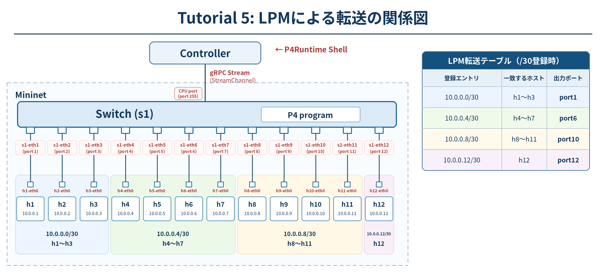

# Tutorial 5: LPMによる宛先IPv4アドレスの転送

Tutorial 4では、宛先IPv4アドレスの完全一致（exact match）によって出力ポートを決定した。本チュートリアルでは、同じ宛先IPv4アドレスを検索キーとし、最長プレフィックス一致（Longest Prefix Match：LPM）による転送を実行する。

## 目的

IPv4アドレスのプレフィックス長に基づくテーブル検索を行い、次の2点を確認する。

1. 1つのLPMエントリが、複数の宛先IPv4アドレスに一致すること。
2. 複数のエントリが一致した場合、プレフィックス長が最も長いエントリが選択されること。

## システム構成



## LPMの概要

LPM（Longest Prefix Match：最長プレフィックス一致）とは、宛先IPアドレスと転送テーブルに登録されたネットワークプレフィックスを比較し、一致するエントリのうちプレフィックス長が最も長いものを選択する方式である。

Tutorial 4で使用したexact matchは、宛先IPv4アドレスが登録されたアドレスと完全に一致する場合にエントリを選択する。一方、LPMでは、共通するネットワークプレフィックスを持つ複数のIPアドレスに対して、1つのエントリで同じ転送ルールを適用できる。

### プレフィックス長と一致範囲

IPv4アドレスは32ビットで構成される。LPMでは、プレフィックス長を用いて、IPアドレスの先頭から何ビットを比較するかを指定する。プレフィックス長を30ビットとした場合、先頭30ビットが比較対象となり、残りの2ビットは比較対象とならない。

例えば、転送テーブルに次のエントリを登録した場合を考える。

```text
10.0.0.4/30 → port6
```

`10.0.0.4/30`の末尾にある`/30`は、プレフィックス長が30ビットであることを表す。比較しない部分はワイルドカードとして扱われ、末尾2ビットが`00`、`01`、`10`、`11`のいずれであっても一致する。

| 項目 | 値 |
| --- | --- |
| ネットワークプレフィックス | `10.0.0.4/30` |
| サブネットマスク | `255.255.255.252` |
| 比較対象 | 先頭30ビット |
| 比較対象外（ワイルドカード） | 末尾2ビット |

`10.0.0.4/30`では、IPv4アドレスの先頭30ビットを比較し、最後の2ビットは比較しない。そのため、最後の2ビットだけが異なる`10.0.0.4`から`10.0.0.7`までの4つのIPアドレスが、同じエントリに一致する。

| 宛先IPv4アドレス | 最後の8ビット | `10.0.0.4/30`との一致 |
| --- | --- | --- |
| `10.0.0.4` | `00000100` | 一致 |
| `10.0.0.5` | `00000101` | 一致 |
| `10.0.0.6` | `00000110` | 一致 |
| `10.0.0.7` | `00000111` | 一致 |

これらのIPアドレスは先頭30ビットが共通しているため、1つの`/30`エントリに一致する。残りの2ビットはワイルドカードとして扱われ、0と1のどちらの値であっても一致すると判定される。

`10.0.0.5/30`が属するネットワークも同じ範囲であるが、転送テーブルにはホスト部を0にしたネットワークアドレス`10.0.0.4/30`を登録する。

### 最長プレフィックス一致によるエントリの選択

次に、以下の2件を同じ転送テーブルへ登録した場合を考える。

| 登録エントリ | アクション |
| --- | --- |
| `10.0.0.4/30` | `forward(6)` |
| `10.0.0.5/32` | `forward(5)` |

宛先IPアドレスが`10.0.0.5`の場合、両方のエントリが一致する。しかし、`/32`の方が`/30`よりプレフィックス長が長いため、LPMでは`10.0.0.5/32`が選択され、ポート5へ転送される。

一方、宛先IPアドレスが`10.0.0.6`の場合、`10.0.0.5/32`には一致しないため、`10.0.0.4/30`が選択され、ポート6へ転送される。このようにLPMでは、広いアドレス範囲をまとめて扱いながら、特定のアドレスに対して異なる転送ルールを適用できる。

## 実験環境

Mininet上に1台のP4スイッチ（`s1`）と12台のホスト（`h1`～`h12`）を配置する。各ホストには、`10.0.0.1`から`10.0.0.12`までのIPv4アドレスが順番に割り当てられる。また、各ホストはスイッチの異なるポートに接続される。例えば、h1はport1、h2はport2、h12はport12に接続される。

### ホストと接続ポートの対応

表に、各ホストのIPv4アドレス、スイッチへの接続ポート、および本実験で登録する4件の`/30`エントリによって選択される出力ポートを示す。

| ホスト | IPv4アドレス | s1の接続ポート | LPMの出力ポート（`/30`登録後） |
| --- | --- | --- | --- |
| h1 | `10.0.0.1` | 1 | 1 |
| h2 | `10.0.0.2` | 2 | 1 |
| h3 | `10.0.0.3` | 3 | 1 |
| h4 | `10.0.0.4` | 4 | 6 |
| h5 | `10.0.0.5` | 5 | 6 |
| h6 | `10.0.0.6` | 6 | 6 |
| h7 | `10.0.0.7` | 7 | 6 |
| h8 | `10.0.0.8` | 8 | 10 |
| h9 | `10.0.0.9` | 9 | 10 |
| h10 | `10.0.0.10` | 10 | 10 |
| h11 | `10.0.0.11` | 11 | 10 |
| h12 | `10.0.0.12` | 12 | 12 |

「接続ポート」は各ホストが実際に接続されるポート、「LPMの出力ポート」は転送エントリによって選択されるポートを表す。

## 使用するP4プログラムとファイル

本実験では、LPMによる照合を行う`proto05.p4`と、そのコンパイル済みファイルを使用する。`ipv4_table`のマッチタイプは、あらかじめ`lpm`に設定されている。

```p4
table ipv4_table {
    key = {
        hdr.ipv4.dstAddr : lpm;
    }
    actions = {
        forward;
        drop;
    }
    size = 1024;
    default_action = drop();
}
```

Tutorial 4で使用した`exact`とは異なり、本実験では`lpm`による一致判定を行う。P4プログラムの編集やコンパイルは行わず、次のファイルを使用する。

| ファイル | 用途 |
| --- | --- |
| `proto05.p4` | P4プログラムのソースコード |
| `proto05.json` | BMv2スイッチに読み込むコンパイル済みファイル |
| `p4info.txtpb` | P4Runtime Shellがテーブルやアクションの定義を参照するためのファイル |
| `proto05.p4i` | プリプロセッサによる展開結果。実験時の読み込みには使用しない |

## 実験手順

### STEP 01 配布ファイルを配置・確認する

リポジトリの`proto05`ディレクトリに、上記のファイルが格納されていることを確認する。リポジトリのルートで次を実行し、Tutorial 0で作成した`/tmp/P4Runtime-protoswitch`に配置する。

```bash
$ cp -r proto05 /tmp/P4Runtime-protoswitch/
```

続いて、配置されたファイルを確認する。以下にコマンドと出力例を示す。

```console
$ ls /tmp/P4Runtime-protoswitch/proto05/
p4info.txtpb  proto05.json  proto05.p4  proto05.p4i
```

`proto05`ディレクトリに、上記の4つのファイルがすべて存在することを確認する。このうち、`proto05.json`と`p4info.txtpb`は、後述するP4Runtime Shellの起動時に使用する。

### STEP 02 MininetとP4Runtime Shellを起動する

最初にMininetを起動する。`--arp`によって各ホストにARPエントリを事前登録し、IPv4パケットの転送を観察する。

```bash
$ docker run --privileged --rm -it \
  -p 50001:50001 \
  -e LOGLEVEL=debug -e PKTDUMP=true -e IPV6=false \
  yutakayasuda/p4mn --topo single,12 --mac --arp
```

`mininet>`で`net`を実行し、`h1`が`s1-eth1`、`h5`が`s1-eth5`、`h6`が`s1-eth6`に接続されていることを確認する。

別のターミナルで、リポジトリのルートディレクトリからP4Runtime Shellを起動する。

```bash
$ docker run --rm -ti \
  -v "$(pwd)/proto05":/proto05 \
  p4lang/p4runtime-sh \
  --grpc-addr host.docker.internal:50001 \
  --device-id 1 --election-id 0,1 \
  --config /proto05/p4info.txtpb,/proto05/proto05.json
```

P4Runtime Shellで転送テーブルの定義を確認します。

**コマンドと出力例｜転送テーブルの定義**

```console
P4Runtime sh >>> tables["MyIngress.ipv4_table"]
Out[1]:
preamble {
  ...
  name: "MyIngress.ipv4_table"
  alias: "ipv4_table"
}
match_fields {
  ...
  name: "hdr.ipv4.dstAddr"
  bitwidth: 32
  match_type: LPM
}
...
P4Runtime sh >>>
```

検索キーが`hdr.ipv4.dstAddr`であることを確認します。

マッチタイプが`LPM`であることを確認します。

### STEP 03 プレフィックス長を指定して転送ルールを登録する

次の表に、本実験で登録するプレフィックス長30ビットの転送エントリと、各エントリの出力ポートを示す。この表には、各プレフィックスに一致するIPv4アドレスのうち、Mininetのホストに設定されているアドレスだけを記載している。

| ネットワークプレフィックス | Mininet上の該当IPv4アドレス | 出力ポート | 本実験での登録 |
| --- | --- | --- | --- |
| `10.0.0.0/30` | `10.0.0.1`～`10.0.0.3` | 1 | 登録する |
| `10.0.0.4/30` | `10.0.0.4`～`10.0.0.7` | 6 | 登録する |
| `10.0.0.8/30` | `10.0.0.8`～`10.0.0.11` | 10 | 登録する |
| `10.0.0.12/30` | `10.0.0.12` | 12 | 登録する |

`10.0.0.0`は、`10.0.0.0/30`のネットワークアドレスであるため、ホストには割り当てていない。そのため、Mininet上に`10.0.0.0`を持つホストは存在しない。

最初に、`10.0.0.0/30`に一致するパケットをポート1へ転送するルールを登録する。

**コマンド｜転送ルールの登録**

```console
P4Runtime sh >>> te = table_entry["MyIngress.ipv4_table"](action="MyIngress.forward")
P4Runtime sh >>> te.match["hdr.ipv4.dstAddr"] = "10.0.0.0/30"
P4Runtime sh >>> te.action.set(port="1")
P4Runtime sh >>> te.insert()
```

Tutorial 4では、宛先IPv4アドレスを完全一致で指定した。今回は`10.0.0.0/30`と指定し、宛先IPv4アドレスの先頭30ビットを照合する。

次のコマンドで、登録した転送ルールを確認する。

**コマンドと出力例｜登録した転送ルールの確認**

```console
P4Runtime sh >>> table_entry["MyIngress.ipv4_table"].read(lambda e: print(e))
table_id: 50177836 ("MyIngress.ipv4_table")
match {
  field_id: 1 ("hdr.ipv4.dstAddr")
  lpm {
    value: "\\x0a\\x00\\x00\\x00"
    prefix_len: 30
  }
}
action {
  action {
    action_id: 29683729 ("MyIngress.forward")
    params {
      param_id: 1 ("port")
      value: "\\x01"
    }
  }
}
P4Runtime sh >>>
```

`value: "\\x0a\\x00\\x00\\x00"`は、IPv4アドレス`10.0.0.0`を表す。

`prefix_len: 30`から、プレフィックス長が30ビットであることを確認する。

`value: "\\x01"`から、出力ポートが1に設定されていることを確認する。

続いて、同じ手順で残りの3件の転送ルールを登録する。登録時には、`te.match["hdr.ipv4.dstAddr"]`のプレフィックスと、`te.action.set(port=...)`の出力ポートを次の値に変更する。

| プレフィックス | 出力ポート |
| --- | --- |
| `10.0.0.4/30` | 6 |
| `10.0.0.8/30` | 10 |
| `10.0.0.12/30` | 12 |

最後に、4件の転送ルールが登録され、それぞれのプレフィックス長と出力ポートが設定どおりであることを確認する。

### STEP 04 LPMによる転送結果を確認する

Mininetから、h1を送信元としてh6へpingを送信する。

**コマンドと出力例｜h1からh6への通信**

```console
mininet> h1 ping -c 3 h6
PING h6 (10.0.0.6) 56(84) bytes of data.
64 bytes from h6 (10.0.0.6): icmp_seq=1 ttl=64 time=0.096 ms
64 bytes from h6 (10.0.0.6): icmp_seq=2 ttl=64 time=0.100 ms
64 bytes from h6 (10.0.0.6): icmp_seq=3 ttl=64 time=0.104 ms

--- h6 ping statistics ---
3 packets transmitted, 3 received, 0% packet loss
```

要求パケットの宛先`10.0.0.6`は`10.0.0.4/30`に一致し、ポート6へ転送される。応答パケットの宛先`10.0.0.1`は`10.0.0.0/30`に一致し、ポート1へ転送される。`0% packet loss`から、h1とh6の間で通信が成功したことを確認する。

次に、送信先をh5へ変更する。

**コマンドと出力例｜h1からh5への通信**

```console
mininet> h1 ping -c 3 h5
PING h5 (10.0.0.5) 56(84) bytes of data.

--- h5 ping statistics ---
3 packets transmitted, 0 received, 100% packet loss
```

宛先`10.0.0.5`も`10.0.0.4/30`に一致するため、パケットはポート6へ転送される。しかしh5が接続されているのはポート5である。そのため、この時点でh5からの応答は得られない。

この失敗は**テーブルに一致するエントリが存在しないためではない**。LPMによる一致判定は成立しているが、アクションに指定した出力ポートが宛先ホストの接続ポートと異なるために生じる。

同様に、ほかのホストへの通信を確認する。

h1を送信元とした場合、h6、h10、h12への通信は成功する。一方、それ以外のホストへの通信は、転送ルールで指定された出力ポートと各ホストの接続ポートが異なるため失敗する。

### STEP 05 /32のエントリを追加する

`10.0.0.5`宛てのパケットのみをポート5へ転送するエントリを追加する。

```python
P4Runtime sh >>> te = table_entry["MyIngress.ipv4_table"](action="MyIngress.forward")
P4Runtime sh >>> te.match["hdr.ipv4.dstAddr"] = "10.0.0.5/32"
P4Runtime sh >>> te.action.set(port="5")
P4Runtime sh >>> te.insert()
```

この時点で、宛先`10.0.0.5`には`10.0.0.4/30`と`10.0.0.5/32`の2件が一致する。LPMではより長い`/32`のエントリが優先されるため、ポート5が選択される。一方、宛先`10.0.0.6`には`/32`のエントリが存在しないため、従来どおり`/30`によってポート6が選択される。

Mininetから、次の2つの通信を実行する。

**コマンドと出力例｜h1からh5への通信**

```console
mininet> h1 ping -c 3 h5
PING h5 (10.0.0.5) 56(84) bytes of data.
64 bytes from h5 (10.0.0.5): icmp_seq=1 ttl=64 time=0.098 ms
64 bytes from h5 (10.0.0.5): icmp_seq=2 ttl=64 time=0.102 ms
64 bytes from h5 (10.0.0.5): icmp_seq=3 ttl=64 time=0.105 ms

--- h5 ping statistics ---
3 packets transmitted, 3 received, 0% packet loss
```

**コマンドと出力例｜h1からh6への通信**

```console
mininet> h1 ping -c 3 h6
PING h6 (10.0.0.6) 56(84) bytes of data.
64 bytes from h6 (10.0.0.6): icmp_seq=1 ttl=64 time=0.096 ms
64 bytes from h6 (10.0.0.6): icmp_seq=2 ttl=64 time=0.100 ms
64 bytes from h6 (10.0.0.6): icmp_seq=3 ttl=64 time=0.104 ms

--- h6 ping statistics ---
3 packets transmitted, 3 received, 0% packet loss
```

h5とh6の両方から応答が得られれば、プレフィックス長によるエントリの選択を確認できる。エントリの登録順序ではなく、プレフィックス長の大小によって選択される点に注意する。

## 実験結果の整理


本実験のように各ホストがスイッチの異なるポートに直接接続されている場合、単一の`/30`エントリによって4台すべてのホストへ正しく転送することはできない。通常のIPルーティングでは、同じネットワークプレフィックスに属する複数の宛先に対し、そのネットワークへ到達する共通の出力インターフェースまたは次ホップを指定する。本実験ではLPMの一致判定と最長一致の優先関係を観察するため、意図的に1つのプレフィックスに複数のホストが含まれる構成を使用している。

